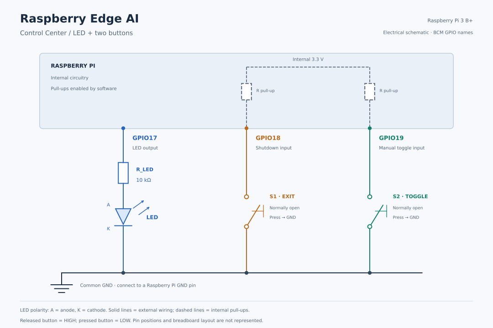

# Raspberry Edge AI

Raspberry Edge AI is a project to build a local intelligence system for **environmental monitoring** and **home security** on Raspberry Pi. It brings together embedded control, sensor and camera data, and models developed with Python and Keras.

The intended result is a system that can collect information from its surroundings, interpret it on the device, and trigger hardware actions or notifications. C provides the embedded foundations; Python and Keras support model development and the future inference pipeline.

The project is developed incrementally. The sections below distinguish the final vision, the capabilities currently implemented, and the additions recorded through successive commits.

## Final project vision

### Intelligent environmental monitoring

Collect measurements using the sensors provided with the **Freenove FNK0020 Ultimate Starter Kit**, process and store the data, and use AI models to detect anomalies and relevant patterns. The initial environmental monitoring scope uses kit components without additional sensor purchases.

| Planned measurement | Kit component | Intended use |
|---|---|---|
| Ambient temperature (°C) | DHT11 | Track temperature changes and supply real readings to the temperature-control application |
| Relative humidity (% RH) | DHT11 | Track moisture conditions alongside temperature |
| Relative ambient light level | Photoresistor and ADC module | Record changes in illumination and distinguish brighter and darker conditions |

A thermistor is also available in the kit as an alternative temperature-acquisition exercise using an ADC. It is not required alongside the DHT11 for the initial dataset. The Freenove documentation covers ADS7830 and PCF8591 ADC variants; the actual module must be identified before wiring and implementation.

Record each sample with its acquisition time, validate readings, and build time series for later analysis and Keras model development. Connect the results to local indicators and hardware responses. Photoresistor readings initially represent relative light levels, not calibrated lux measurements.

These are planned integrations. The current application still receives temperatures from the keyboard; sensor acquisition and dataset logging have not yet been implemented. Component availability and the ADC variant will be checked against the physical kit before integration. The sensor scope follows the [official Freenove FNK0020 tutorials](https://docs.freenove.com/projects/fnk0020/en/latest/fnk0020/python-tutorial.html).

### Home security with computer vision

Use the kit's **HC-SR501 PIR sensor** to record motion events and support the security application. A PIR detects movement and does not reliably establish whether a stationary person remains present. PIR integration is planned.

The longer-term vision also includes a camera and facial recognition to distinguish known faces from unrecognized faces. Camera hardware is outside the initial kit-sensor scope. The planned application has two operating states:

- **DISARMED:** notifications for unrecognized faces are disabled.
- **ARMED:** an unrecognized face can trigger a notification to the user.

Camera acquisition, model selection, recognition thresholds, and the notification channel remain to be developed. Accuracy, false positives, latency, and resource consumption must be evaluated on the target hardware before the system can be considered reliable.

### Planned processing flow

| Stage | Purpose |
|---|---|
| Acquisition | Read physical sensors and capture camera images |
| Data preparation | Validate, organize, and record measurements and images |
| Model development | Train and evaluate models with Python and Keras |
| Edge inference | Run suitable models locally on Raspberry Pi |
| Response | Update hardware outputs and generate application notifications |

These are target capabilities, not a description of an already completed system. The current alarm state belongs to the temperature/LED control application; it is separate from the future ARMED/DISARMED security states.

## Development status

The current development milestone is a **Hardware Control Center** written in C. It establishes GPIO control and keyboard/button event handling before physical sensors and AI inference are integrated.

| Area | Status |
|---|---|
| Modular C application and Make-based build | Implemented |
| LED control from manually entered temperatures | Implemented |
| Keyboard and GPIO button handling with `poll()` | Implemented |
| Shared event-driven threshold/temperature input, signed values, and oversized-line recovery | Implemented for interactive terminal input |
| Numeric range checks and button debounce | Incomplete |
| Python/Keras practice notebooks | Included as standalone exercises |
| Physical sensor acquisition and dataset logging | Planned |
| Integrated on-device inference | Planned |
| Camera-based security and notifications | Planned |

The notebooks are learning resources, not an inference pipeline connected to the C application. The development board is currently a Raspberry Pi 3 B+; model feasibility and performance on this device remain to be measured.

## Current capabilities

- Accept an integer threshold and manually entered temperature readings.
- Monitor standard input and GPIO button events through one `poll()` call, including while waiting for the initial threshold.
- Reuse one stateful input reader for threshold and temperature entry, preserving partial lines across reads.
- Accept signed decimal integers, including `-1`, within a three-character line limit before Enter.
- Reject empty input, nonnumeric input, and characters between the number and newline; keep running so the user can retry.
- Reject oversized lines and discard their remaining characters through the newline before accepting another interactive line.
- Drive an LED on GPIO17 with hysteresis: turn on above `threshold + 1`, turn off at or below `threshold - 1`, and retain the current state between those boundaries.
- Toggle the LED manually with GPIO19 while waiting for either the threshold or a temperature.
- Shut down with GPIO18, attempting to turn the LED off and release the GPIO request and controller.
- Report the temperature comparison and alarm state; after threshold entry, refresh the visible terminal area when an event arrives.

### Current hardware controls

| GPIO line | Connection | Action |
|---|---|---|
| GPIO17 | LED with current-limiting resistor | Automatic control and manual toggle |
| GPIO18 | Button to ground, internal pull-up | Orderly shutdown |
| GPIO19 | Button to ground, internal pull-up | Invert the LED state |



Electrical schematic for the current circuit. The dashed pull-ups are internal to the Raspberry Pi and enabled by software; solid lines show external wiring. `A` and `K` identify the LED anode and cathode. This schematic shows electrical connections, not breadboard positions.

GPIO numbers are offsets within the selected controller, not physical header pin numbers. The current controller path is `/dev/gpiochip0`; verify it for the board being used.

Button events use falling-edge detection without `ACTIVE_LOW`: pressing a button changes its input from high to low. Debouncing is not yet implemented.

The manual button changes the actual LED state. Subsequent valid temperatures apply hysteresis to that state, so a reading inside the hysteresis band preserves the manual result.

## Build and run the current application

Requirements:

- Linux with the GPIO character device API v2 and compatible headers.
- A C11 compiler available as `gcc`, and Make.
- Access to `/dev/gpiochip0` and available GPIO lines 17, 18, and 19.
- The LED and buttons wired as described above.
- A terminal supporting the display-control sequences used by the application.

From the repository root on the Raspberry Pi:

```sh
make
./control_center
```

The Makefile compiles `main.c`, `io.c`, `temperature.c`, and `gpio.c`, then links `control_center`. It enables C11 and `-Wall -Wextra -Wpedantic`. Use `make -B` to force a complete rebuild.

Enter the threshold first, then one temperature per line. Both use the same five-byte buffer: at most three characters before Enter, followed by a newline and string terminator. An optional `+` or `-` sign counts toward the limit: `123`, `-12`, `+25`, `0`, and `-1` fit; `1234` and `-123` are rejected.

The input policy rejects an invalid line as a whole: it never accepts a numeric prefix as a replacement for that line. For example, `12x` is rejected because it contains an unexpected suffix; `123x` and `1234` are rejected because they exceed the three-character limit. This length limit is an intentional design choice. Oversized lines are discarded through their newline, and the next interactive line can be read normally without a false EOF or shutdown. Invalid input leaves the current value and LED state unchanged. A rejected threshold keeps the application in threshold-entry mode. GPIO19 toggles the LED and GPIO18 exits during either input phase. Use an interactive terminal and submit one line at a time; arbitrary piped or redirected input is not yet supported reliably.

End-of-input (for example, Ctrl+D at an empty terminal input line) and read errors trigger cleanup and shutdown. Both currently produce a nonzero application exit status.

For example, with threshold `30` and the LED initially off:

| Action | LED result |
|---|---|
| Enter `31` | Off: not strictly above the turn-on boundary `31` |
| Enter `32` | On |
| Enter `30` | Remains on, inside the hysteresis band |
| Enter `29` | Off |
| Press GPIO19 | On |
| Press GPIO18 | Shutdown; LED switch-off attempted before releasing resources |

The threshold comparison message and LED state may differ because the LED uses hysteresis. No physical temperature sensor is read yet. Python and Keras are not required to build or run this C milestone. Native macOS headers do not provide the Linux GPIO interfaces used by the full application.

## Repository components

The paths below are tracked by Git and are part of the project's shared files.

| Path | Purpose |
|---|---|
| `main.c` | Application entry point, event loop, temperature logic, button actions, and cleanup |
| `io.c` / `io.h` | Menu, `input_state` structure, shared `init_input()` / `read_input()` reader, integer conversion, and terminal display helpers |
| `temperature.c` / `temperature.h` | Threshold comparison and hysteresis |
| `gpio.c` / `gpio.h` | GPIO controller access, line requests, values, and descriptor cleanup |
| `Makefile` | Main application build |
| `Keras_Practice/` | Standalone Keras notebooks for learning and experimentation |

## Known limitations

| Area | Current limitation |
|---|---|
| Button debounce | Contact bounce can generate several events for one press, causing repeated toggles. Falling-edge detection alone does not filter bounce. |
| Multiple lines per read | The reader treats each accumulated buffer as one line. If a read contains a newline followed by part of another line, the remaining characters are not preserved correctly. Piped or redirected input and input batching require further work. |
| Numeric range | The parser does not check `strtol()` overflow or the range before casting to `int`. The current three-character limit keeps ordinary decimal keyboard values within range on the target, but the parser is not ready for unrestricted longer strings. Threshold arithmetic is not independently protected against integer overflow. |
| Event ordering | One GPIO event is read per iteration. Stdin is processed first if both sources are ready; shutdown has no guaranteed priority over pending work. |
| Terminal display | After threshold entry, a GPIO event can erase the visible echo of unfinished input without removing it from pending input. Prompts are not consistently redisplayed after rejected lines or button events. The interface is not yet a persistent dashboard. |
| I/O errors and EOF | Interrupted calls have no dedicated retry policy. EOF and read errors share the same reader result and both cause a nonzero exit status. |

Interactive operation has been reported working on the Raspberry Pi during development. Targeted local checks also covered valid signed input, rejected suffixes, partial-line accumulation, oversized-line recovery, a subsequent valid line, and EOF. These checks do not establish general support for arbitrary byte streams or verify button debounce.

## Roadmap

1. **Harden embedded control:** finish numeric range checks, support multiple input lines per read, add debounce, improve terminal prompts, and make shutdown/event handling more predictable.
2. **Acquire real data:** integrate the kit DHT11 and photoresistor/ADC for temperature, humidity, and relative light measurements; add PIR motion events and record timestamped datasets with reproducible sampling and logging.
3. **Develop models:** build and evaluate Keras pipelines for environmental anomalies and camera-based recognition.
4. **Deploy locally:** adapt selected models to the target device and measure accuracy, latency, and resource use.
5. **Integrate the applications:** connect acquisition, inference, hardware actions, and the planned security notifications.