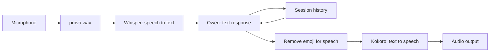

# Nova — Local Voice Assistant

Nova is a Python learning prototype for a local, turn-based voice assistant on **Apple Silicon Macs**. It records a spoken question, transcribes it in Italian, generates a text response, and speaks the response with an Italian female voice.

The current prototype runs the models on the Mac. It has no paid inference API dependency. Model downloads and Hugging Face metadata checks can require an Internet connection; cached offline operation is configurable in the script.

## Current features

- Press Enter to record a new **three-second** microphone clip; type `q` and press Enter to exit.
- Transcribe the recording with multilingual Whisper, currently configured for Italian.
- Generate responses with **Qwen3-4B Instruct**, served locally by Ollama.
- Keep user and assistant messages in memory for the current session.
- Speak responses with **Kokoro-82M**, using the Italian female voice **`if_sara`**.
- Remove Unicode emoji from the text sent to the voice model while preserving the original response in the conversation history.
- Reuse the voice pipeline and the in-process Whisper model across turns.
- Print timings for transcription, the Ollama request, and speech generation.

## How it works



Python handles recording, transcription, history, and speech synthesis. The Python Ollama client sends text requests to a separate Ollama service on the same Mac. The voice pipeline uses the final response text, not the complete response object or metadata.

## Models

| Task | Model or voice | Execution |
|---|---|---|
| Speech recognition | `mlx-community/whisper-small-mlx` | MLX in the Python process |
| Text generation | `qwen3:4b-instruct` | Local Ollama service |
| Speech synthesis | `hexgrad/Kokoro-82M`, voice `if_sara` | PyTorch on CPU in the current configuration |

Use the exact **`qwen3:4b-instruct`** tag. The previously tried `qwen3:4b` configuration produced extended thinking output and is not the configuration used by this prototype.

The three stages use different sample rates: the microphone's default rate for recording, 16 kHz after Whisper's input conversion, and 24 kHz for Kokoro playback. The WAV is saved with its real recording sample rate; FFmpeg handles the conversion for transcription.

## Installation

The dependency snapshot targets **macOS on Apple Silicon and Python 3.12**. It is not an installation recipe for Raspberry Pi, Linux, or Intel Macs.

See **[INSTALL.md](INSTALL.md)** for prerequisites, environment creation, model downloads, and audio-device configuration. Python dependencies are pinned in **[requirements.txt](requirements.txt)**, including transitive packages captured from the working development environment.

With Homebrew, uv, and a running Ollama installation already available, the installation steps from the repository root are:

```sh
brew install ffmpeg espeak-ng
cd nova
uv venv --python 3.12 .venv
uv pip install --python .venv/bin/python -r requirements.txt
ollama pull qwen3:4b-instruct
```

Create `.venv` only when it does not already exist. The Python package named `ollama` is a client and does not install or start the Ollama application/service.

Whisper and Kokoro download their model files and voice assets on first use. These files are cached outside the source code and are not included in the dependency file. This dependency snapshot has not yet been validated by a fresh installation from a clean clone.

## Configure and run

From `nova/`, list the audio devices:

```sh
.venv/bin/python -m sounddevice
```

The current script sets `microfono = 0`, uses `device=1` for playback, and records for `durata = 3` seconds. Update these values in **[nova.py](nova.py)** to match your hardware. Device identifiers can change when audio devices are connected or disconnected. Allow microphone access if macOS requests it.

Start Nova:

```sh
.venv/bin/python nova.py
```

Press Enter, wait for `Parla ora`, and speak within the recording window. Nova prints the transcription and response, speaks the response, and returns to the prompt. After it finishes, press Enter for another turn, or enter `q` to exit.

For a short context check, say `Mi chiamo Alberto` on the first turn and `Qual è il mio nome?` on the next. Check the transcription as well as the answer: recognition errors are also passed to the language model.

**[registra.py](registra.py)** is a separate three-second recording/playback diagnostic. It is not required to run `nova.py`.

## Recordings, history, and model lifetime

- Each recording overwrites **`prova.wav` in the working directory**. The most recent clip remains on disk after the program exits; it is not automatically deleted.
- Conversation history is held in the Python process. It is reset when the program restarts and is not written to a conversation database.
- `.venv`, Python bytecode, and WAV recordings are excluded by the local **[.gitignore](.gitignore)**.
- Exiting Nova releases its Python process but may leave Qwen loaded by the Ollama service for reuse. Inspect it with `ollama ps`; unload it explicitly with `ollama stop qwen3:4b-instruct` when it is no longer needed. This does not delete the downloaded model.

## Current limitations and validation

- Fixed recording duration: no automatic end-of-speech detection or wake word.
- Turn-based operation: the program does not handle spoken interruptions while it is responding.
- Italian configuration: multilingual model capability does not mean an English end-to-end workflow has been validated here.
- Session-only history: no persistent memories, retrieval, forgetting commands, or context-trimming policy. The model has a finite context window; the current list of messages grows during the session.
- No connection to Atlas, the Hardware Control Center, Cerberus, or an iPhone app.
- No application-level recovery for missing devices, failed model requests, or synthesis failures; these can stop the script.
- Short local conversations, voice playback, session-name recall, and model reuse have been manually exercised on a **MacBook Air M4 with 16 GB unified memory**. Timings vary with model loading, response length, context, and other applications. Sustained memory/thermal behavior and a clean installation have not been comprehensively tested.
- Specific dependency warnings are filtered for readability. `HF_HUB_OFFLINE` is currently commented out; enabling it requires all necessary files to be cached first, and it must be disabled to fetch new assets.

## Planned work

1. Variable-duration recording and end-of-turn detection.
2. Activation by name and conversation shutdown controls.
3. Bounded context and persistent memories with explicit deletion.
4. Validated operations and status queries through Atlas.
5. A future iPhone interface with a replaceable inference backend.

These are planned features, not current capabilities.

## Upstream projects

- [Whisper / MLX implementation](https://github.com/ml-explore/mlx-examples/tree/main/whisper)
- [Qwen3-4B-Instruct-2507](https://huggingface.co/Qwen/Qwen3-4B-Instruct-2507)
- [Ollama](https://github.com/ollama/ollama)
- [Kokoro](https://github.com/hexgrad/kokoro)

Model weights and third-party packages retain their own licenses; consult their upstream repositories and model cards.
